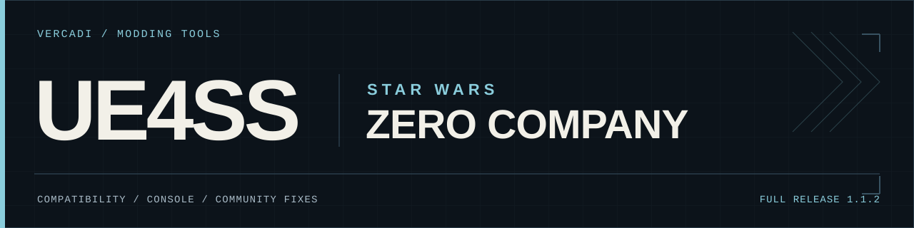

**[Download the complete v1.1.2 ZIP](https://github.com/Vercadi/ue4ss-star-wars-zero-company/releases/download/v1.1.2/UE4SS_for_Star_Wars_Zero_Company_v1.1.2_Steam-EA.zip)** · **[Nexus Mods](https://www.nexusmods.com/starwarszerocompany/mods/9?tab=files)** · [Community fixes](https://github.com/Vercadi/ue4ss-star-wars-zero-company/issues)

The complete released package, ready to install or patch: `dwmapi.dll` and the `ue4ss` folder. This mirrors **v1.1.2**; publishing it here does not add a new compatibility fix.

> **Community maintenance**
>
> I’m not actively investigating new compatibility reports. If you can help, share a tested fix below. Community test ZIPs are welcome in issues and comments; changes are reviewed before an official Nexus release. Further updates are not guaranteed.

## Install

1. Close the game. Back up your existing `dwmapi.dll` and complete `ue4ss` folder outside the game directory.
2. Extract the full ZIP into `SWZeroCompany\Binaries\Win64`, beside `SWZeroCompany.exe`, replacing included files.
3. Launch normally through your store client.

Custom settings are replaced; extra mods are not removed. **Rollback:** close the game and restore your backup. To disable the loader temporarily, move its `dwmapi.dll` outside `Win64`.

## Help patch it

1. **Download and edit.** Extract the release and change the relevant files, usually in `ue4ss/UE4SS_Signatures/`.
2. **Test.** Check startup, F10, save loading, entering a mission and normal exit where possible. State anything you could not test.
3. **Share.** Submit a pull request, or [open an issue](https://github.com/Vercadi/ue4ss-star-wars-zero-company/issues/new) and attach your changed files or a complete community test ZIP. You can also share it in an existing issue’s comments. Label it clearly as a community test.

Include what failed, what you changed, your storefront/game version, mods used and a fresh `UE4SS.log`. If no log was created, say so. A diagnostic report is helpful if available. For proposed DLL changes, include the corresponding source changes and build/test details.

**No Python, packaging tools or manual hash updates are required.** Keep personal details, game EXEs, PDBs, saves and dumps out of public attachments.

## What has been tested

On local executable **199049**, v1.1.1 initialized and F10 and save loading worked. The **v1.1.2 scripts passed offline checks** against that executable; they were not runtime-tested in that session. This does not confirm every storefront, game build or mod.

## Credits and source

Built on [UE4SS and its contributors](https://github.com/UE4SS-RE/RE-UE4SS), using source revision [a1e7f571](https://github.com/UE4SS-RE/RE-UE4SS/tree/a1e7f571c789f63f3de6773d056be6f778c14dc8). The included DLL retains the existing two-byte FName branch patch at file offset `0x34E550` (`74 49` → `90 90`). This repository contains the released runtime; native source is linked above.

Thanks to the community members who supplied reports, files and testing. See [CREDITS.txt](CREDITS.txt) and the [UE4SS license](ue4ss/LICENSE).

If you’d like to support my modding work, [buy me a coffee on Ko-fi](https://ko-fi.com/vercadi). Donations are optional and do not guarantee further updates.
